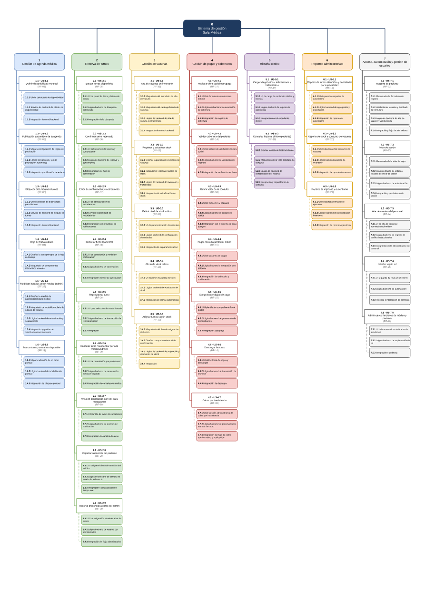

# WBS

Fuente: [WBS.pdf](WBS.pdf).

Texto extraído del PDF, separado por página. Los saltos de línea siguen el documento; la distribución visual debe consultarse en el original.


## Página 1

### Lectura por módulo

#### Módulo 1

Gestión de agenda médica  
1.1 · US-1.1  
Definir disponibilidad mensual  
(RF-01)  
1.1.1 UI del calendario de disponibilidad  
1.1.2 Servicio de backend de cálculo de  
disponibilidad  
1.1.3 Integración frontend-backend  
1.2 · US-1.2  
Publicación automática de la agenda  
(RF-02)  
1.2.1 UI para configuración de reglas de  
publicación  
1.2.2 Lógica de backend y job de  
publicación automática  
1.2.3 Integración y notificación de estado  
1.3 · US-1.3  
Bloquear días, franjas o turnos  
(RF-03)  
1.3.1 UI de selección de días/rangos  
para bloqueo  
1.3.2 Servicio de backend de bloqueo de  
turnos  
1.3.3 Integración frontend-backend  
1.4 · US-1.4  
Hoja de trabajo diaria  
(RF-04)  
1.4.1 Diseñar la tabla principal de la hoja  
de trabajo  
1.4.2 Maquetado de componentes  
interactivos visuales  
1.5 · US-1.5  
Modificar horarios de un médico (admin)  
(RF-27)  
1.5.1 Diseñar la interfaz de  
agenda/calendario médico  
1.5.2 Maquetado de modal/formulario de  
edición de horarios  
1.5.3 Lógica backend de actualización y  
solapamiento  
1.5.4 Integración y gestión de  
sobreturnos/cancelaciones  
1.6 · US-1.6  
Marcar turno puntual no disponible  
(RF-28)  
1.6.1 UI para selección de un turno  
puntual  
1.6.2 Lógica backend de inhabilitación  
puntual  
1.6.3 Integración de bloqueo puntual  

#### Módulo 2

Reserva de turnos  
2.1 · US-2.1  
Buscar turnos disponibles  
(RF-05)  
2.1.1 UI de panel de filtros y listado de  
turnos  
2.1.2 Lógica backend de búsqueda  
optimizada  
2.1.3 Integración de la búsqueda  
2.2 · US-2.2  
Confirmar turno reservado  
(RF-06)  
2.2.1 UI del resumen de reserva y  
comprobante  
2.2.2 Lógica de backend de reserva y  
concurrencia  
2.2.3 Integración del flujo de  
confirmación  
2.3 · US-2.3  
Email de confirmación y recordatorios  
(RF-07)  
2.3.1 UI de configuración de  
recordatorios  
2.3.2 Servicio backend/job de  
recordatorios  
2.3.3 Integración con proveedor de  
notificaciones  
2.4 · US-2.4  
Cancelar turno (paciente)  
(RF-08)  
2.4.1 UI de cancelación y modal de  
confirmación  
2.4.2 Lógica backend de cancelación  
2.4.3 Integración de flujo de cancelación  
2.5 · US-2.5  
Reprogramar turno  
(RF-08)  
2.5.1 UI para selección de nuevo horario  
2.5.2 Lógica backend de transacción de  
reprogramación  
2.5.3 Integración  
2.6 · US-2.6  
Cancelar turno / suspender período  
(médico/admin)  
(RF-09)  
2.6.1 UI de cancelación por profesional  
2.6.2 Lógica backend de cancelación  
médica e impacto  
2.6.3 Integración de cancelación médica  
2.7 · US-2.7  
Aviso de cancelación con link para  
reprogramar  
(RF-10)  
2.7.1 UI/plantilla de aviso de cancelación  
2.7.2 Lógica backend de eventos de  
notificación  
2.7.3 Integración de canales de aviso  
2.8 · US-2.8  
Registrar asistencia del paciente  
(RF-29)  
2.8.1 UI del panel diario de atención del  
médico  
2.8.2 Lógica de backend de cambio de  
estado de asistencia  
2.8.3 Integración y actualización en  
tiempo real  
2.9 · US-2.9  
Reserva presencial a cargo del admin  
(RF-30)  
2.9.1 UI de asignación administrativa de  
turnos  
2.9.2 Lógica backend de reserva por  
administrador  
2.9.3 Integración del flujo administrativo  

#### Módulo 3

Gestión de vacunas  
3.1 · US-3.1  
Alta de vacunas en inventario  
(RF-33)  
3.1.1 Maquetado del formulario de alta  
de vacuna  
3.1.2 Maquetado del catálogo/listado de  
vacunas  
3.1.3 Lógica de backend de alta de  
vacuna y persistencia  
3.1.4 Integración frontend-backend  
3.2 · US-3.2  
Registrar y actualizar stock  
(RF-11)  
3.2.1 Diseñar la pantalla de inventario de  
vacunas  
3.2.2 Indicadores y alertas visuales de  
stock  
3.2.3 Lógica de backend de inventario y  
trazabilidad  
3.2.4 Integración de actualización de  
stock  
3.3 · US-3.3  
Definir nivel de stock crítico  
(RF-32)  
3.3.1 UI de parametrización de umbrales  
3.3.2 Lógica backend de configuración  
de umbrales  
3.3.3 Integración de la parametrización  
3.4 · US-3.4  
Alerta de stock crítico  
(RF-13)  
3.4.1 UI de panel de alertas de stock  
3.4.2 Lógica backend de evaluación de  
stock  
3.4.3 Integración de alertas automáticas  
3.5 · US-3.6  
Asignar turnos según stock  
(RF-12)  
3.6.1 Maquetado del flujo de asignación  
de turnos  
3.6.2 Diseñar comprobante/modal de  
confirmación  
3.6.3 Lógica de backend de asignación y  
descuento de stock  
3.6.4 Integración  

#### Módulo 4

Gestión de pagos y coberturas  
4.1 · US-4.1  
Registrar obra social o prepaga  
(RF-14)  
4.1.1 UI de formulario de cobertura  
médica  
4.1.2 Lógica de backend de asociación  
de cobertura  
4.1.3 Integración de registro de  
cobertura  
4.2 · US-4.2  
Validar cobertura del paciente  
(RF-14)  
4.2.1 UI de estado de validación de obra  
social  
4.2.2 Lógica backend de validación de  
vigencia  
4.2.3 Integración de verificación en línea  
4.3 · US-4.3  
Definir valor de la consulta  
(RF-34)  
4.3.1 UI de aranceles y copagos  
4.3.2 Lógica backend de cálculo de  
costos  
4.3.3 Integración con el sistema de citas  
y pagos  
4.4 · US-4.4  
Pagar consulta particular online  
(RF-15)  
4.4.1 UI de pasarela de pagos  
4.4.2 Lógica backend e integración con  
gateway  
4.4.3 Integración de webhooks y  
confirmación  
4.5 · US-4.5  
Comprobante digital de pago  
(RF-16)  
4.5.1 UI/plantilla de comprobante fiscal  
digital  
4.5.2 Lógica backend de generación de  
comprobantes  
4.5.3 Integración post-pago  
4.6 · US-4.6  
Descargar facturas  
(RF-16)  
4.6.1 UI del historial de pagos y  
descargas  
4.6.2 Lógica backend de transmisión de  
archivos  
4.6.3 Integración de descarga  
4.7 · US-4.7  
Cobro por inasistencia  
(RF-35)  
4.7.1 UI de gestión administrativa de  
cobro por inasistencia  
4.7.2 Lógica backend de procesamiento  
manual de cobro  
4.7.3 Integración del flujo de cobro  
administrativo y notificación  

#### Módulo 5

Historial clínico  
5.1 · US-5.1  
Cargar diagnósticos, indicaciones y  
tratamientos  
(RF-17)  
5.1.1 UI de carga de evolución médica y  
recetas  
5.1.2 Lógica backend de registro de  
atenciones  
5.1.3 Integración con el expediente  
clínico  
5.2 · US-5.2  
Consultar historial clínico (paciente)  
(RF-18)  
5.2.1 Diseñar la vista de historial clínico  
5.2.2 Maquetado de la vista detallada de  
consulta  
5.2.3 Lógica de backend de  
consolidación del historial  
5.2.4 Integración y seguridad en la  
consulta  

#### Módulo 6

Reportes administrativos  
6.1 · US-6.1  
Reporte de turnos atendidos y cancelados  
por especialidad  
(RF-19)  
6.1.1 UI de panel de reportes de  
ausentismo  
6.1.2 Lógica backend de agregación y  
exportación  
6.1.3 Integración de reporte de  
ausentismo  
6.2 · US-6.2  
Reporte de stock y consumo de vacunas  
(RF-20)  
6.2.1 UI de dashboard de consumo de  
vacunas  
6.2.2 Lógica backend analítica de  
inventario  
6.2.3 Integración de reporte de vacunas  
6.3 · US-6.3  
Reporte de ingresos y ausentismo  
(RF-21)  
6.3.1 UI de dashboard financiero  
ejecutivo  
6.3.2 Lógica backend de consolidación  
financiera  
6.3.3 Integración de reportes ejecutivos  

#### Módulo 7

Acceso, autenticación y gestión de  
usuarios  
7.1 · US-7.1  
Registro de paciente  
(RF-22)  
7.1.1 Maquetado del formulario de  
registro  
7.1.2 Validaciones visuales y feedback  
de formulario  
7.1.3 Lógica de backend de alta de  
usuario y validaciones  
7.1.4 Integración y flujo de alta exitosa  
7.2 · US-7.2  
Inicio de sesión  
(RF-23)  
7.2.1 Maquetado de la vista de login  
7.2.2 Implementación de estados  
visuales de inicio de sesión  
7.2.3 Lógica backend de autenticación  
7.2.4 Integración y persistencia de  
sesión  
7.3 · US-7.3  
Alta de cuentas del personal  
(RF-24)  
7.3.1 UI de alta de personal  
administrativo/médico  
7.3.2 Lógica backend de registro de  
perfiles institucionales  
7.3.3 Integración de la administración de  
personal  
7.4 · US-7.4  
Interfaz según rol  
(RF-25)  
7.4.1 UI y guards de rutas en el cliente  
7.4.2 Lógica backend de autorización  
7.4.3 Pruebas e integración de permisos  
7.5 · US-7.5  
Admin ejerce funciones de médico y  
paciente  
(RF-26)  
7.5.1 UI del conmutador e indicador de  
simulación  
7.5.2 Lógica backend de suplantación de  
rol  
7.5.3 Integración y auditoría  

### Extracción completa por posición

```text
0
Sistema de gestión
Sala Médica
7
1    2    3    4    5    6
Acceso, autenticación y gestión de
Gestión de agenda médica    Reserva de turnos    Gestión de vacunas    Gestión de pagos y coberturas    Historial clínico    Reportes administrativos
usuarios
5.1 · US-5.1    6.1 · US-6.1
1.1 · US-1.1    2.1 · US-2.1    3.1 · US-3.1    4.1 · US-4.1    7.1 · US-7.1
Cargar diagnósticos, indicaciones y    Reporte de turnos atendidos y cancelados
Definir disponibilidad mensual    Buscar turnos disponibles    Alta de vacunas en inventario    Registrar obra social o prepaga    Registro de paciente
tratamientos    por especialidad
(RF-01)    (RF-05)    (RF-33)    (RF-14)    (RF-22)
(RF-17)    (RF-19)
1.1.1UI del calendario de disponibilidad    2.1.1UI de panel de filtros y listado de    3.1.1Maquetado del formulario de alta    4.1.1UI de formulario de cobertura    5.1.1UI de carga de evolución médica y    6.1.1UI de panel de reportes de    7.1.1Maquetado del formulario de
turnos    de vacuna    médica    recetas    ausentismo    registro
1.1.2Servicio de backend de cálculo de    2.1.2Lógica backend de búsqueda    3.1.2Maquetado del catálogo/listado de    4.1.2Lógica de backend de asociación    5.1.2Lógica backend de registro de    6.1.2Lógica backend de agregación y    7.1.2Validaciones visuales y feedback
disponibilidad    optimizada    vacunas    de cobertura    atenciones    exportación    de formulario
1.1.3Integración frontend-backend    2.1.3Integración de la búsqueda    3.1.3Lógica de backend de alta de    4.1.3Integración de registro de    5.1.3Integración con el expediente    6.1.3Integración de reporte de    7.1.3Lógica de backend de alta de
vacuna y persistencia    cobertura    clínico    ausentismo    usuario y validaciones
3.1.4Integración frontend-backend    7.1.4Integración y flujo de alta exitosa
1.2 · US-1.2    2.2 · US-2.2    4.2 · US-4.2    5.2 · US-5.2    6.2 · US-6.2
Publicación automática de la agenda    Confirmar turno reservado    Validar cobertura del paciente    Consultar historial clínico (paciente)    Reporte de stock y consumo de vacunas
(RF-02)    (RF-06)    (RF-14)    (RF-18)    (RF-20)
3.2 · US-3.2    7.2 · US-7.2
Registrar y actualizar stock    Inicio de sesión
1.2.1UI para configuración de reglas de    2.2.1UI del resumen de reserva y    4.2.1UI de estado de validación de obra    5.2.1Diseñar la vista de historial clínico    6.2.1UI de dashboard de consumo de
publicación    comprobante    (RF-11)    social    vacunas    (RF-23)
1.2.2Lógica de backend y job de    2.2.2Lógica de backend de reserva y    3.2.1Diseñar la pantalla de inventario de    4.2.2Lógica backend de validación de    5.2.2Maquetado de la vista detallada de    6.2.2Lógica backend analítica de    7.2.1Maquetado de la vista de login
publicación automática    concurrencia    vacunas    vigencia    consulta    inventario
1.2.3Integración y notificación de estado    2.2.3Integración del flujo de    3.2.2Indicadores y alertas visuales de    4.2.3Integración de verificación en línea    5.2.3Lógica de backend de    6.2.3Integración de reporte de vacunas    7.2.2Implementación de estados
confirmación    stock    consolidación del historial    visuales de inicio de sesión
3.2.3Lógica de backend de inventario y    5.2.4Integración y seguridad en la    7.2.3Lógica backend de autenticación
trazabilidad    consulta
1.3 · US-1.3    2.3 · US-2.3    4.3 · US-4.3    6.3 · US-6.3
Bloquear días, franjas o turnos    Email de confirmación y recordatorios    Definir valor de la consulta    Reporte de ingresos y ausentismo
(RF-03)    (RF-07)    3.2.4Integración de actualización de    (RF-34)    (RF-21)    7.2.4Integración y persistencia de
stock    sesión
1.3.1UI de selección de días/rangos    2.3.1UI de configuración de    4.3.1UI de aranceles y copagos    6.3.1UI de dashboard financiero
para bloqueo    recordatorios    ejecutivo
3.3 · US-3.3    7.3 · US-7.3
Definir nivel de stock crítico    Alta de cuentas del personal
1.3.2Servicio de backend de bloqueo de    2.3.2Servicio backend/job de    4.3.2Lógica backend de cálculo de    6.3.2Lógica backend de consolidación
turnos    recordatorios    (RF-32)    costos    financiera    (RF-24)
1.3.3Integración frontend-backend    2.3.3Integración con proveedor de    3.3.1UI de parametrización de umbrales    4.3.3Integración con el sistema de citas    6.3.3Integración de reportes ejecutivos    7.3.1UI de alta de personal
notificaciones    y pagos    administrativo/médico
3.3.2Lógica backend de configuración    7.3.2Lógica backend de registro de
de umbrales    perfiles institucionales
1.4 · US-1.4    2.4 · US-2.4    4.4 · US-4.4
Hoja de trabajo diaria    Cancelar turno (paciente)    Pagar consulta particular online
(RF-04)    (RF-08)    (RF-15)    7.3.3Integración de la administración de
3.3.3Integración de la parametrización
personal
1.4.1Diseñar la tabla principal de la hoja    2.4.1UI de cancelación y modal de    4.4.1UI de pasarela de pagos
de trabajo    confirmación
3.4 · US-3.4    7.4 · US-7.4
Alerta de stock crítico    Interfaz según rol
1.4.2Maquetado de componentes    2.4.2Lógica backend de cancelación    4.4.2Lógica backend e integración con
interactivos visuales    (RF-13)    gateway    (RF-25)
2.4.3Integración de flujo de cancelación    3.4.1UI de panel de alertas de stock    4.4.3Integración de webhooks y    7.4.1UI y guards de rutas en el cliente
confirmación
1.5 · US-1.5
Modificar horarios de un médico (admin)
(RF-27)    3.4.2Lógica backend de evaluación de
7.4.2Lógica backend de autorización
stock
2.5 · US-2.5    4.5 · US-4.5
Reprogramar turno    Comprobante digital de pago
1.5.1Diseñar la interfaz de
agenda/calendario médico    (RF-08)    3.4.3Integración de alertas automáticas    (RF-16)    7.4.3Pruebas e integración de permisos
1.5.2Maquetado de modal/formulario de    2.5.1UI para selección de nuevo horario    4.5.1UI/plantilla de comprobante fiscal
edición de horarios    digital
7.5 · US-7.5
3.5 · US-3.6
Admin ejerce funciones de médico y
Asignar turnos según stock
1.5.3Lógica backend de actualización y    2.5.2Lógica backend de transacción de    4.5.2Lógica backend de generación de    paciente
solapamiento    reprogramación    (RF-12)    comprobantes    (RF-26)
1.5.4Integración y gestión de    2.5.3Integración    3.6.1Maquetado del flujo de asignación    4.5.3Integración post-pago    7.5.1UI del conmutador e indicador de
sobreturnos/cancelaciones    de turnos    simulación
3.6.2Diseñar comprobante/modal de    7.5.2Lógica backend de suplantación de
2.6 · US-2.6    confirmación    rol
1.6 · US-1.6    4.6 · US-4.6
Cancelar turno / suspender período
Marcar turno puntual no disponible    Descargar facturas
(médico/admin)
(RF-28)    3.6.3Lógica de backend de asignación y    (RF-16)
(RF-09)    7.5.3Integración y auditoría
descuento de stock
1.6.1UI para selección de un turno    2.6.1UI de cancelación por profesional    4.6.1UI del historial de pagos y
puntual    3.6.4Integración    descargas
1.6.2Lógica backend de inhabilitación    2.6.2Lógica backend de cancelación    4.6.2Lógica backend de transmisión de
puntual    médica e impacto    archivos
1.6.3Integración de bloqueo puntual    2.6.3Integración de cancelación médica    4.6.3Integración de descarga
2.7 · US-2.7
4.7 · US-4.7
Aviso de cancelación con link para
Cobro por inasistencia
reprogramar
(RF-35)
(RF-10)
2.7.1UI/plantilla de aviso de cancelación    4.7.1UI de gestión administrativa de
cobro por inasistencia
2.7.2Lógica backend de eventos de    4.7.2Lógica backend de procesamiento
notificación    manual de cobro
2.7.3Integración de canales de aviso    4.7.3Integración del flujo de cobro
administrativo y notificación
2.8 · US-2.8
Registrar asistencia del paciente
(RF-29)
2.8.1UI del panel diario de atención del
médico
2.8.2Lógica de backend de cambio de
estado de asistencia
2.8.3Integración y actualización en
tiempo real
2.9 · US-2.9
Reserva presencial a cargo del admin
(RF-30)
2.9.1UI de asignación administrativa de
turnos
2.9.2Lógica backend de reserva por
administrador
2.9.3Integración del flujo administrativo
```


